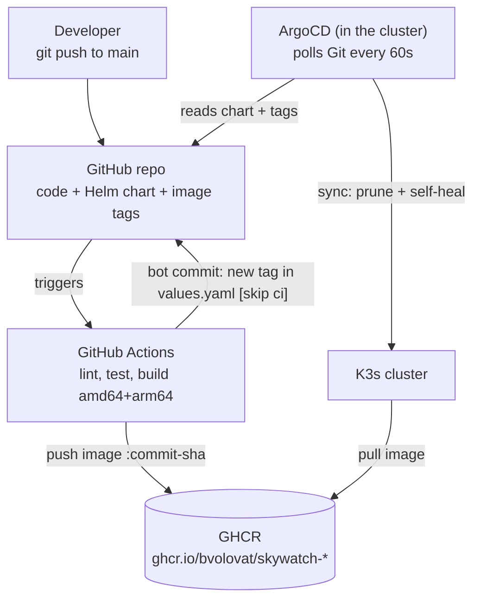
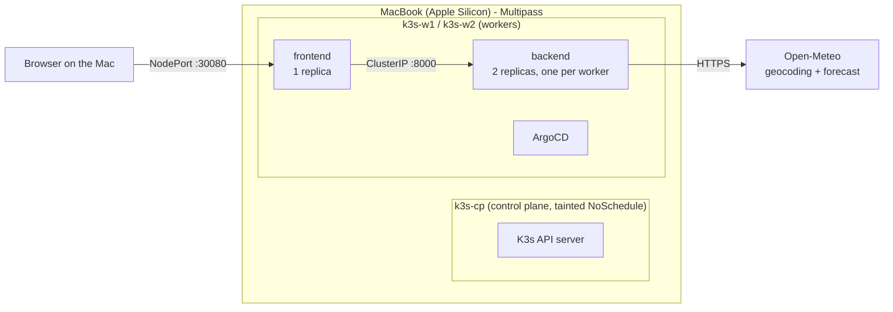

# SkyWatch

A small two-service weather app (Flask frontend + backend API calling [Open-Meteo](https://open-meteo.com)), running on
a local 3-node K3s cluster, built by GitHub Actions and delivered by ArgoCD. A push to `main` reaches the cluster with no
manual `kubectl` or `helm` command.

**Path chosen: A (full)**: 3 Ubuntu VMs with Multipass on an Apple Silicon Mac (16 GB), K3s installed by Ansible.

- [Architecture](#architecture)
- [Bring it up from scratch](#bring-it-up-from-scratch)
- [Proof of the GitOps flow](#proof-of-the-gitops-flow)
- [Design decisions](#design-decisions)
- [Problems I ran into and how I solved them](#problems-i-ran-into-and-how-i-solved-them)
- [What I would improve with more time](#what-i-would-improve-with-more-time)
- [Reference](#reference): repository layout, configuration, lint and tests, local run

---

## Architecture

### Delivery: from `git push` to running pods



Git is the single source of truth. CI never talks to the cluster: it only builds images and records the desired image tag
in Git. ArgoCD runs inside the cluster and *pulls* the desired state, so nothing on the laptop has to be reachable from
the internet.

### Runtime: the cluster and a request



| VM | Role | CPU | RAM | Disk |
|----|------|-----|-----|------|
| `k3s-cp` | control plane (no app workloads) | 2 | 1.5 GB | 10G |
| `k3s-w1` | worker | 2 | 2.5 GB | 15G |
| `k3s-w2` | worker | 2 | 2.5 GB | 15G |

---

## Bring it up from scratch

### 1. Prerequisites (macOS)

| Tool | Needed for | Required? | Install | Check |
|------|-------------|-----------|---------|-------|
| Multipass | runs the 3 Ubuntu VMs | yes | `brew install --cask multipass` | `multipass version` |
| Ansible | installs K3s and ArgoCD on the VMs | yes | `brew install ansible` | `ansible --version` |
| kubectl | talking to the cluster from the Mac | yes | `brew install kubectl` | `kubectl version --client` |
| git | cloning and pushing the repo | yes | ships with Xcode Command Line Tools | `git --version` |
| gh | following CI runs (`gh run watch`) | optional | `brew install gh` | `gh auth status` |
| Helm | linting / rendering the chart locally (ArgoCD installs it in the cluster) | optional | `brew install helm` | `helm version` |
| Docker | only to build and run the images locally; not used by the cluster (K3s has its own containerd) | optional | Docker Desktop | `docker version` |

Tested with: macOS on Apple Silicon (M1 Pro, 16 GB), Ansible core 2.21, kubectl 1.36, K3s v1.36.6+k3s1.

Resources: about 7 GB of free RAM for the VMs (close Docker Desktop while the cluster runs), about 40 GB of disk,
and a GitHub account.

### 2. If you fork this repo

The repo owner appears in two files. Replace `bvolovat` with your GitHub user:

- `charts/skywatch/values.yaml`: `backend.image.repository` and `frontend.image.repository`
- `argocd/application.yaml`: `spec.source.repoURL`

CI derives the image names from the repository owner automatically. Push once to `main` so CI builds and publishes the
images, then make both GHCR packages public (GitHub → your profile → Packages → `skywatch-backend` /
`skywatch-frontend` → Package settings → Change visibility → Public), so the cluster can pull them without credentials.

### 3. Create the VMs and the cluster

```bash
# 3 Ubuntu 24.04 VMs + a dedicated SSH key + the Ansible inventory (idempotent: re-run safely)
./infra/multipass/create-vms.sh

# K3s (pinned) on the control plane, join the workers, install ArgoCD, register the app,
# then wait until ArgoCD reports the app Healthy
cd infra/ansible
ansible-playbook site.yml
cd -
```

A first run takes about 10-15 minutes, most of it image downloads. The end of the output prints the URLs.

### 4. Use it

```bash
export KUBECONFIG=$PWD/kubeconfig
kubectl get nodes -o wide
kubectl -n argocd get applications
```

| What | Where |
|------|-------|
| SkyWatch | `http://<worker-ip>:30080` (e.g. `http://192.168.252.3:30080`) |
| ArgoCD UI | `http://<worker-ip>:30081`, user `admin` |
| ArgoCD password | `kubectl -n argocd get secret argocd-initial-admin-secret -o jsonpath='{.data.password}' \| base64 -d; echo` |

### 5. Ship a change

```bash
git pull --rebase       # CI adds a tag-bump commit to main after every push, so pull it first
# edit code, e.g. apps/frontend/templates/index.html
git commit -am "..." && git push
```

About 3 minutes later the new version is live: CI (~1.5 min), then ArgoCD's next poll (≤70 s), then a rolling update.

### 6. Stop or tear down

```bash
multipass stop --all                 # keep everything, free the RAM; `multipass start --all` to resume
./infra/multipass/destroy-vms.sh     # delete the VMs, the inventory and the kubeconfig
```

---

## Proof of the GitOps flow

A one-line change to the page subtitle, pushed to `main`, rolled out with no manual step:

1. Commit `cf17cf0` ("Frontend: update subtitle") is pushed.
2. CI builds and pushes `ghcr.io/bvolovat/skywatch-*:cf17cf0...`, then the bot commits `55a75c4`
   ("ci: bump image tags to cf17cf0 [skip ci]"). No second CI run is started.
3. ArgoCD detects the new tag on its next poll and rolls the pods.
4. The page shows the new subtitle.


| ArgoCD: app Synced and Healthy | The app in the cluster |
|---|---|
|  |  |

Idempotent provisioning: a second `ansible-playbook site.yml` on a healthy cluster changes nothing:


Self-heal: `kubectl scale deploy skywatch-backend -n skywatch --replicas=5` is reverted to 2 by ArgoCD within seconds.

---

## Design decisions

### Application (`apps/`)
- **Minimal Flask services, configured only through environment variables** (URLs, timeouts, ports, log level, gunicorn
  workers). No address is hard-coded in the code.
- **Liveness vs readiness**: `/healthz` (process is up) and `/readyz` (ready for traffic). Readiness deliberately does
  *not* call Open-Meteo: an outage of the external API must not pull every backend pod out of the Service.
- **Clear error mapping**: 400 for a missing city, 404 for an unknown city, 502 when Open-Meteo is unreachable; the
  frontend shows a friendly message instead of failing.
- **Images**: multi-stage build (dependencies installed in a venv, only the venv and the code copied to the final image),
  `python:3.12-slim`, non-root UID 10001, gunicorn instead of the Flask dev server, `.dockerignore` keeps tests out.
  About 50 MB each.

### Provisioning (`infra/`)
- **Multipass + cloud-init**: the script injects a dedicated SSH key and writes the Ansible inventory from the live VM IPs.
- **Pinned K3s**: `k3s_version` in `infra/ansible/group_vars/k3s_cluster.yml`. The install script is fetched from the same
  git tag, so the installer itself is pinned. Bumping the version and re-running the playbook performs an upgrade.
- **Idempotent by design**: each role reads `k3s --version` first and only runs the installer when K3s is missing or on
  another version. Configuration lives in templated `/etc/rancher/k3s/config.yaml` files; a change triggers a restart
  through a handler. ArgoCD is installed by dropping manifests into the directory K3s watches, so the task only reports
  a change when the content changes.
- **No workloads on the control plane**: the server carries `node-role.kubernetes.io/control-plane:NoSchedule`; workers
  get the `node-role.kubernetes.io/worker=true` label from the control plane.

### Helm chart (`charts/skywatch`)
- **One small chart for the app**: three templates. `frontend.yaml` (Deployment + NodePort Service), `backend.yaml`
  (Deployment with 2 replicas + ClusterIP Service) and `configmaps.yaml` (one ConfigMap per service). Labels are written
  out in each template, with no helper functions, so every file reads top to bottom.
- **Config from values, not images**: everything comes from `values.yaml` through ConfigMaps (`envFrom`). `BACKEND_URL` is
  built from the backend Service name. A `checksum/config` annotation rolls the pods when a ConfigMap changes.
- **Resilience**: `topologySpreadConstraints` put the two backend replicas on different workers.
- **Resources sized from measurement**: `kubectl top pods` showed ~60Mi memory and 1-4m CPU per pod at idle, so
  memory requests are 96Mi (real usage plus headroom), CPU requests 50m, limits 500m CPU / 256Mi memory.
- **Probes and resources** on every container; **hardening**: non-root, read-only root filesystem (with an `emptyDir` on
  `/tmp` for gunicorn), all capabilities dropped, `RuntimeDefault` seccomp.
- **Immutable tags**: images are tagged with the full commit SHA, so `pullPolicy: IfNotPresent` is safe and every
  deployed version maps to one commit.

### CI (`.github/workflows/ci.yaml`)

| Job | Runs on | What it does |
|-----|---------|--------------|
| `test-app` | push + PR | `ruff` lint/format, `pytest` (9 unit tests), `hadolint` |
| `lint-infra` | push + PR | `helm lint`, `kubeconform` (rendered chart), `ansible-lint`, `shellcheck` |
| `build` (backend, frontend) | push + PR, after both | `linux/amd64` + `linux/arm64` images; pushed to GHCR as `:<commit-sha>` on `main` only |
| `update-tags` | push to `main` | writes the SHA into `values.yaml` with `yq` and pushes a bot commit |

- **No trigger loop**: the bot commit is pushed with `GITHUB_TOKEN`, and GitHub never starts workflow runs from
  `GITHUB_TOKEN` pushes. `[skip ci]` in the message is a second guard.
- **Caching**: pip cache in `setup-python`; Docker layer cache in the GitHub Actions cache (`type=gha`), one scope per service.
- **Races**: `concurrency` cancels a superseded run on the same branch; the bump job rebases on `main` before pushing.
- **arm64**: the VMs on Apple Silicon are arm64 while GitHub's default runners are amd64, so images are multi-arch.
- **Pinned runners** (`ubuntu-24.04`) so the build environment does not change under the pipeline.

### GitOps (`argocd/`)
- ArgoCD is installed by K3s's built-in Helm controller from a pinned `argo-cd` chart (`10.11.7`, Argo CD v3.5.7), with
  dex and notifications disabled to save memory on the small workers.
- The `skywatch` Application deploys `charts/skywatch` from `main` with `automated` sync, `prune: true`, `selfHeal: true`,
  `CreateNamespace=true` and retry with backoff.
- GitHub webhooks cannot reach a laptop, so ArgoCD polls every 60 s (+ up to 10 s jitter) instead of the default 120 s (+60 s).
- The ArgoCD UI is on NodePort `30081` (its chart default, `30080`, is taken by the frontend), over plain HTTP since this
  is a local lab.

### Secrets
No plaintext secret is committed, and none has to be:
- The K3s join token is read from the control plane at run time and kept in Ansible's memory (`no_log`).
- The host `kubeconfig` (cluster-admin credentials) and the generated inventory are git-ignored.
- The ArgoCD admin password is generated inside the cluster (`argocd-initial-admin-secret`) and never leaves it.
- Images are public on GHCR, so no registry pull secret is needed; CI authenticates with the short-lived `GITHUB_TOKEN`.

If the app needed a real secret (an API key, a Grafana admin password), I would add **Sealed Secrets**: the controller
runs in the cluster, `kubeseal` encrypts the Secret with the controller's public key, and only the encrypted
`SealedSecret` is committed and synced by ArgoCD. External Secrets Operator with a cloud secret manager is the choice once
a cloud provider is involved.

---

## Problems I ran into and how I solved them

| # | Problem | Cause | Fix |
|---|---------|-------|-----|
| 1 | `create-vms.sh` exited silently on the first run, creating nothing | `multipass info` exits non-zero for a VM that does not exist yet; with `set -euo pipefail` that aborted the script (stderr was sent to `/dev/null`) | `\|\| true` in the state lookup, so "no VM" reads as an empty state |
| 2 | Ansible: `Too many authentication failures` | ssh offered every key in the local ssh-agent before the dedicated one, and the VM's `MaxAuthTries` cut the connection | `ansible_ssh_common_args='-o IdentitiesOnly=yes'` in the generated inventory |
| 3 | K3s agents failed to start on both workers | the agent config set `node-label: node-role.kubernetes.io/worker=true`; the NodeRestriction admission plugin forbids a kubelet from giving itself `node-role` labels | removed the label from the agent config; the role applies it from the control plane with `kubectl label` (idempotent) |
| 4 | CI: `ModuleNotFoundError: No module named 'app'` | locally I ran `python -m pytest`, which puts the current directory on `sys.path`; CI ran plain `pytest`, which does not | CI runs `python -m pytest`, the same command as locally |
| 5 | Images would not run on the cluster's architecture | the Multipass VMs on Apple Silicon are arm64, GitHub's runners are amd64 | multi-arch build (`linux/amd64,linux/arm64`) with buildx + QEMU; the pure-Python dependencies keep emulation cheap |
| 6 | ArgoCD's NodePort collided with the frontend | the argo-cd chart defaults to NodePort 30080 | ArgoCD on 30081/30444 |
| 7 | `git push` rejected (`fetch first`) after a CI run | the CI bot commits the new image tags to `main` after every push, so the local branch is one commit behind | `git pull --rebase` before pushing (documented in "Ship a change") |
| 8 | Noisy bot diffs | `yq -i` drops blank lines, so the first bump rewrote the whole `values.yaml` | removed blank lines from `values.yaml`; every bot commit now changes exactly the two tag lines |

---

## What I would improve with more time

- **Build and roll only what changed.** Today every push rebuilds both images and bumps both tags, so ArgoCD restarts
  both services even when only one changed. Path filters per service (or a monorepo build tool) would fix that.
- **An end-to-end test in CI**: spin up k3d in the runner, `helm install` the freshly built images, and `curl` the
  frontend before publishing. Today the end-to-end check is the playbook's "Healthy" gate plus a manual browser test.
- **Supply chain**: vulnerability scan (Trivy) as a gate, SBOM generation, and image signing with cosign verified at
  admission.
- **Separate config repo** (or ArgoCD Image Updater) so the bot does not write to the code branch, and branch
  protection on `main` with a narrow exception for the bot.
- **Secrets**: Sealed Secrets as described above, once there is a real secret.
- **Ingress + TLS** (Traefik ships with K3s) instead of NodePorts, and a webhook into ArgoCD instead of polling.
- **Renovate** to keep pinned versions (K3s, argo-cd chart, base image, actions, Python deps) up to date.
- **Observability**: kube-prometheus-stack, request count/latency metrics from both services, and a Grafana dashboard
  managed by ArgoCD (app-of-apps).
- **Backend robustness**: retries with backoff and a short cache for Open-Meteo responses; an HPA and a
  PodDisruptionBudget on the backend.
- **Terraform** for the VMs, so provisioning has state and a plan step.

---

## Reference

### Repository layout

```
apps/backend/          HTTP API: GET /api/weather?city=..., /healthz, /readyz (+ Dockerfile, tests)
apps/frontend/         Flask page with a city form, calls the backend (+ Dockerfile, tests)
infra/multipass/       create-vms.sh / destroy-vms.sh
infra/ansible/         site.yml + roles: common, k3s_server, k3s_agent, argocd
charts/skywatch/       Helm chart for the whole app
argocd/                ArgoCD Application for the chart
.github/workflows/     CI pipeline
docs/                  screenshots for this README
```

### Configuration

| Service  | Variable               | Default                                          |
|----------|------------------------|--------------------------------------------------|
| backend  | `PORT`                 | `8000`                                           |
| backend  | `GEOCODING_URL`        | `https://geocoding-api.open-meteo.com/v1/search` |
| backend  | `FORECAST_URL`         | `https://api.open-meteo.com/v1/forecast`         |
| backend  | `HTTP_TIMEOUT_SECONDS` | `5`                                              |
| frontend | `PORT`                 | `8080`                                           |
| frontend | `BACKEND_URL`          | `http://localhost:8000` (in-cluster: set by the chart) |
| frontend | `HTTP_TIMEOUT_SECONDS` | `10`                                             |
| both     | `LOG_LEVEL`            | `INFO`                                           |
| both     | `GUNICORN_WORKERS`     | `2`                                              |

In the cluster all of these come from `charts/skywatch/values.yaml`.

### Lint and tests (the same checks CI runs)

```bash
pip install ruff pytest ansible-lint flask requests
ruff check . && ruff format --check .
(cd apps/backend && python -m pytest -q) && (cd apps/frontend && python -m pytest -q)
helm lint charts/skywatch --strict
(cd infra/ansible && ansible-lint --offline)
shellcheck infra/multipass/*.sh
```

Unit tests mock Open-Meteo and the backend, so they need no network and also cover the failure paths.

### Running the services locally (without Kubernetes)

```bash
docker build -t skywatch-backend:dev  apps/backend
docker build -t skywatch-frontend:dev apps/frontend
docker network create skywatch
docker run -d --rm --name backend  --network skywatch skywatch-backend:dev
docker run -d --rm --name frontend --network skywatch -p 8080:8080 \
  -e BACKEND_URL=http://backend:8000 skywatch-frontend:dev
open http://localhost:8080
```
