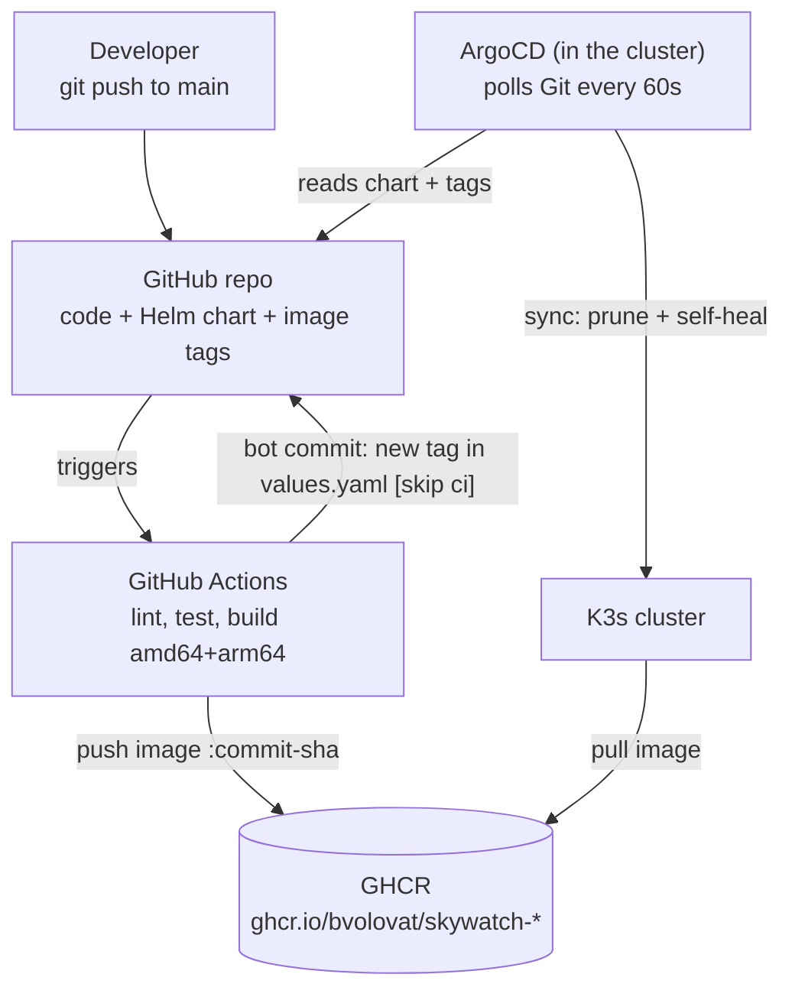
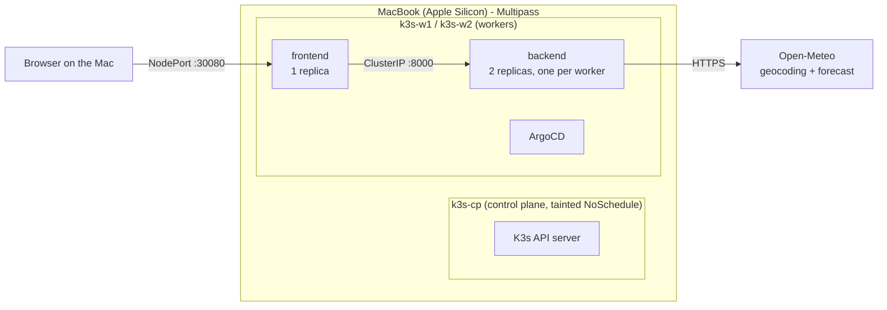
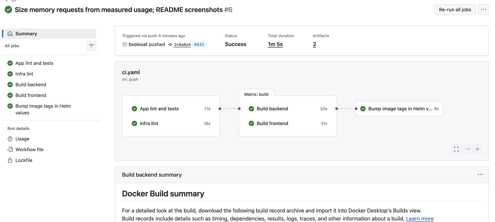
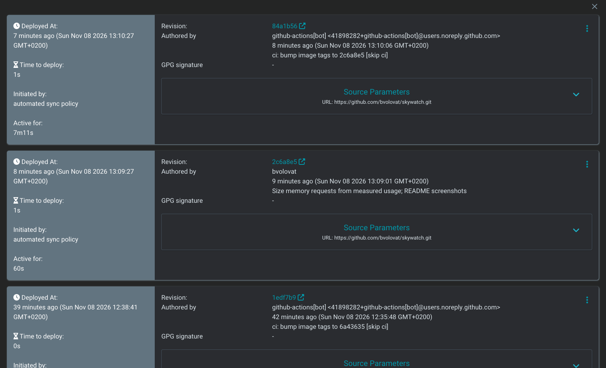
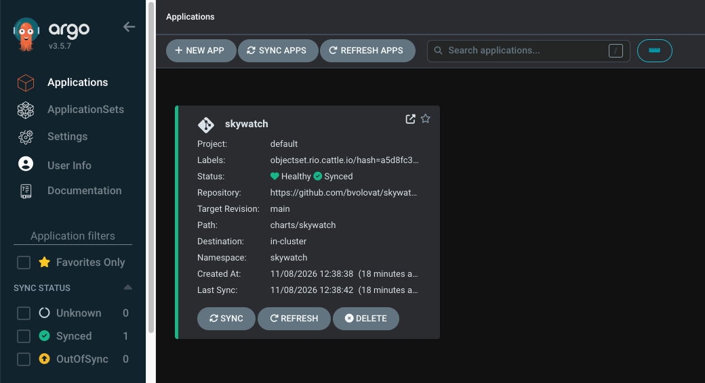
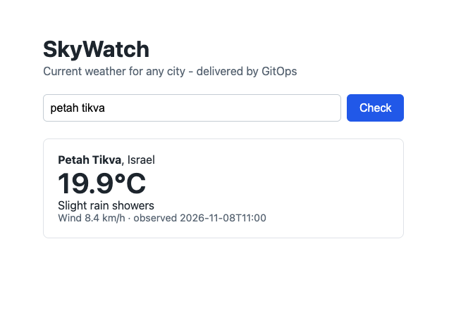
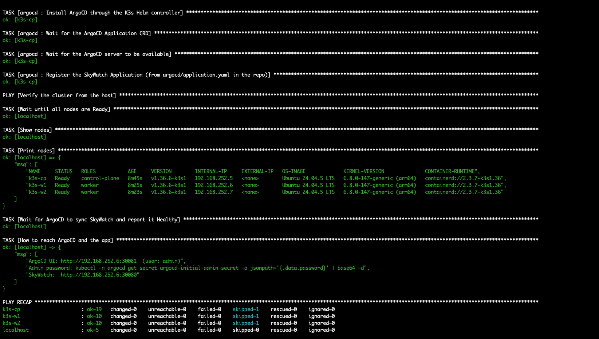

# SkyWatch

A small two-service weather app (Flask frontend + backend API calling [Open-Meteo](https://open-meteo.com)), running on
a local 3-node K3s cluster, built by GitHub Actions and delivered by ArgoCD. A push to `main` reaches the cluster with no
manual `kubectl` or `helm` command.

**Path chosen: A (full)**: 3 Ubuntu VMs with Multipass on an Apple Silicon Mac (16 GB), K3s installed by Ansible.

- [Architecture](#architecture)
- [Bring it up from scratch](#bring-it-up-from-scratch)
- [Proof of the GitOps flow](#proof-of-the-gitops-flow)
- [Design decisions](#design-decisions)
- [Problems I ran into and how I solved them](#problems-i-ran-into-and-how-i-solved-them)
- [What I would improve with more time](#what-i-would-improve-with-more-time)
- [Reference](#reference): repository layout, lint and tests

---

## Architecture

### Delivery: from `git push` to running pods



Git is the single source of truth. CI never talks to the cluster: it only builds images and records the desired image tag
in Git. ArgoCD runs inside the cluster and *pulls* the desired state, so nothing on the laptop has to be reachable from
the internet.

### Runtime: the cluster and a request



| VM | Role | CPU | RAM | Disk |
|----|------|-----|-----|------|
| `k3s-cp` | control plane (no app workloads) | 2 | 1.5 GB | 10G |
| `k3s-w1` | worker | 2 | 2.5 GB | 15G |
| `k3s-w2` | worker | 2 | 2.5 GB | 15G |

---

## Bring it up from scratch

### 1. Prerequisites (macOS)

| Tool | Needed for | Required? | Install | Check |
|------|-------------|-----------|---------|-------|
| Multipass | runs the 3 Ubuntu VMs | yes | `brew install --cask multipass` | `multipass version` |
| Ansible | installs K3s and ArgoCD on the VMs | yes | `brew install ansible` | `ansible --version` |
| kubectl | talking to the cluster from the Mac | yes | `brew install kubectl` | `kubectl version --client` |
| git | cloning and pushing the repo | yes | ships with Xcode Command Line Tools | `git --version` |
| gh | following CI runs (`gh run watch`) | optional | `brew install gh` | `gh auth status` |
| Helm | linting / rendering the chart locally (ArgoCD installs it in the cluster) | optional | `brew install helm` | `helm version` |
| Docker | only to build and run the images locally; not used by the cluster (K3s has its own containerd) | optional | Docker Desktop | `docker version` |

Tested with: macOS on Apple Silicon (M1 Pro, 16 GB), Ansible core 2.21, kubectl 1.36, K3s v1.36.6+k3s1.

Resources: about 7 GB of free RAM for the VMs (close Docker Desktop while the cluster runs), about 40 GB of disk,
and a GitHub account.

### 2. Get the repo

```bash
git clone https://github.com/bvolovat/skywatch.git
cd skywatch
```

That is all you need to run it: the images on GHCR are public and the ArgoCD Application tracks this repo.

### 3. Create the VMs and the cluster

```bash
# 3 Ubuntu 24.04 VMs + a dedicated SSH key + the Ansible inventory (idempotent: re-run safely)
./infra/multipass/create-vms.sh

# K3s (pinned) on the control plane, join the workers, install ArgoCD, register the app,
# then wait until ArgoCD reports the app Healthy
cd infra/ansible
ansible-playbook site.yml
cd -
```

A first run takes about 10-15 minutes, most of it image downloads. The end of the output prints the URLs.

### 4. Use it

```bash
export KUBECONFIG=$PWD/kubeconfig
kubectl get nodes -o wide
kubectl -n argocd get applications
```

| What | Where |
|------|-------|
| SkyWatch | `http://<worker-ip>:30080` (e.g. `http://192.168.252.3:30080`) |
| ArgoCD UI | `http://<worker-ip>:30081`, user `admin` |
| ArgoCD password | `kubectl -n argocd get secret argocd-initial-admin-secret -o jsonpath='{.data.password}' \| base64 -d; echo` |

### 5. Ship a change

```bash
git pull --rebase       # CI adds a tag-bump commit to main after every push, so pull it first
# edit code, e.g. apps/frontend/templates/index.html
git commit -am "..." && git push
```

About 3 minutes later the new version is live: CI (about 1-1.5 min), then ArgoCD's next poll (≤70 s), then a rolling update.

Pushing needs your own fork: replace `bvolovat` in `charts/skywatch/values.yaml` and `argocd/application.yaml`, enable
Actions on the fork, and after the first CI run make the two GHCR packages public.

### 6. Stop or tear down

```bash
multipass stop --all                 # keep everything, free the RAM; `multipass start --all` to resume
./infra/multipass/destroy-vms.sh     # delete the VMs, the inventory and the kubeconfig
```

---

## Proof of the GitOps flow

Two real changes reached the cluster with no manual `kubectl` or `helm` step. Every sync in ArgoCD's history says
"Initiated by: automated sync policy".

**A code change** (page subtitle): commit `cf17cf0` was pushed, CI built and pushed new images, the bot committed
`55a75c4` ("ci: bump image tags to cf17cf0 [skip ci]") and ArgoCD rolled the pods. The new subtitle is visible in the
screenshot of the app below.

**A config change** (memory requests sized from `kubectl top`), timeline from ArgoCD's history:

| Time | Event |
|------|-------|
| 13:09:01 | `2c6a8e5` pushed: `memory: 96Mi` in `values.yaml` |
| 13:09:27 | ArgoCD synced it, 26 s later. A values change needs no new image, so ArgoCD did not wait for CI |
| 13:10:06 | CI finished (1m 5s) and the bot pushed `84a1b56` with the new image tags. No second CI run started |
| 13:10:27 | ArgoCD synced the new images, 21 s later |

CI run for `2c6a8e5`: the two lint jobs run in parallel, then the matrix build, then the tag bump.



ArgoCD history (newest first): the bot's tag bump, the config change, and the previous deployment.



| ArgoCD: app Synced and Healthy | The app in the cluster |
|---|---|
|  |  |

Idempotent provisioning: a second `ansible-playbook site.yml` on a healthy cluster changes nothing:



Self-heal: `kubectl scale deploy skywatch-backend -n skywatch --replicas=5` is reverted to 2 by ArgoCD within seconds.

---

## Design decisions

### Application
- **Configured only through environment variables**, so the same image runs anywhere. In the cluster the values come
  from `values.yaml` through ConfigMaps.
- **Separate liveness (`/healthz`) and readiness (`/readyz`).** Readiness does not call Open-Meteo: if the external API
  is down, the backend pods stay in the Service and return a clear 502, instead of all of them dropping out.
- **Small, non-root images**: multi-stage build on `python:3.12-slim`, gunicorn, UID 10001, about 50 MB each.

### Provisioning
- **Pinned K3s version** (`k3s_version` in `group_vars`), and the install script is fetched from the same version tag.
- **Idempotent playbook**: K3s is installed only when it is missing or on another version, and restarted only when its
  config changes. A second run reports `changed=0`.
- **No workloads on the control plane**: it carries a `NoSchedule` taint.

### Helm chart
- **One chart, three templates**: frontend (Deployment + NodePort Service), backend (Deployment with 2 replicas +
  ClusterIP Service) and the ConfigMaps.
- **Config in values, not in images**. A config change rolls the pods automatically (`checksum/config` annotation).
- **Probes and requests/limits on every container**, with memory requests sized from `kubectl top`. The two backend
  replicas run on different workers.
- **Hardened pods**: non-root, read-only root filesystem, all capabilities dropped.

### CI
- **Stages**: app lint + tests (ruff, pytest, hadolint) and infra lint (helm lint, kubeconform, ansible-lint,
  shellcheck) run in parallel, then both images are built, then a bot commit writes the
  new tags into `values.yaml`. Images are tagged with the commit SHA and pushed only from `main`.
- **Multi-arch** (`amd64` + `arm64`): the VMs on Apple Silicon are arm64, GitHub's runners are amd64.
- **No trigger loop**: the bot pushes with `GITHUB_TOKEN`, which never starts a new run; `[skip ci]` is a second guard.
- **Caching**: pip and Docker layers in the GitHub Actions cache. A newer push cancels an older run on the same branch.

### GitOps
- **ArgoCD** is installed by Ansible from a pinned chart. The `skywatch` Application syncs `charts/skywatch` from `main`
  automatically, with prune and self-heal.
- **Polling every 60 s** instead of a webhook, because GitHub cannot reach a laptop.

### Secrets
No plaintext secret is in Git: the K3s join token stays in Ansible's memory, the kubeconfig is git-ignored, the ArgoCD
admin password is generated inside the cluster, and CI uses the short-lived `GITHUB_TOKEN`. For a real secret (for
example a Grafana password) I would use **Sealed Secrets**: only the encrypted version is committed, and only the
controller in the cluster can decrypt it.

---

## Problems I ran into and how I solved them

| # | Problem | Cause | Fix |
|---|---------|-------|-----|
| 1 | K3s agents failed to start on both workers | the agent config set `node-label: node-role.kubernetes.io/worker=true`; the NodeRestriction admission plugin forbids a kubelet from giving itself `node-role` labels | removed the label from the agent config; the role applies it from the control plane with `kubectl label` (idempotent) |
| 2 | Images would not run on the cluster's architecture | the Multipass VMs on Apple Silicon are arm64, GitHub's runners are amd64 | multi-arch build (`linux/amd64,linux/arm64`) with buildx + QEMU; the pure-Python dependencies keep emulation cheap |
| 3 | `git push` rejected (`fetch first`) after a CI run | the CI bot commits the new image tags to `main` after every push, so the local branch is one commit behind | `git pull --rebase` before pushing (documented in "Ship a change") |

---

## What I would improve with more time

- **Build and roll only what changed.** Today every push rebuilds both images and bumps both tags, so ArgoCD restarts
  both services even when only one changed. Path filters per service (or a monorepo build tool) would fix that.
- **An end-to-end test in CI**: spin up k3d in the runner, `helm install` the freshly built images, and `curl` the
  frontend before publishing. Today the end-to-end check is the playbook's "Healthy" gate plus a manual browser test.
- **Supply chain**: vulnerability scan (Trivy) as a gate, SBOM generation, and image signing with cosign verified at
  admission.
- **Observability**: kube-prometheus-stack, request count/latency metrics from both services, and a Grafana dashboard
  managed by ArgoCD (app-of-apps).

---

## Reference

### Repository layout

```
apps/backend/          HTTP API: GET /api/weather?city=..., /healthz, /readyz (+ Dockerfile, tests)
apps/frontend/         Flask page with a city form, calls the backend (+ Dockerfile, tests)
infra/multipass/       create-vms.sh / destroy-vms.sh
infra/ansible/         site.yml + roles: common, k3s_server, k3s_agent, argocd
charts/skywatch/       Helm chart for the whole app
argocd/                ArgoCD Application for the chart
.github/workflows/     CI pipeline
docs/                  screenshots for this README
```

All runtime configuration (URLs, timeouts, ports, log level, gunicorn workers) is in
`charts/skywatch/values.yaml` and reaches the pods as environment variables through ConfigMaps.

### Lint and tests (the same checks CI runs)

```bash
pip install ruff pytest ansible-lint flask requests
ruff check . && ruff format --check .
(cd apps/backend && python -m pytest -q) && (cd apps/frontend && python -m pytest -q)
helm lint charts/skywatch --strict
(cd infra/ansible && ansible-lint --offline)
shellcheck infra/multipass/*.sh
```

Unit tests mock Open-Meteo and the backend, so they need no network and also cover the failure paths.
